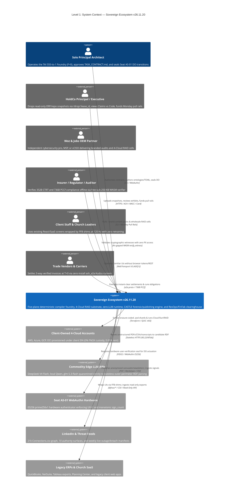
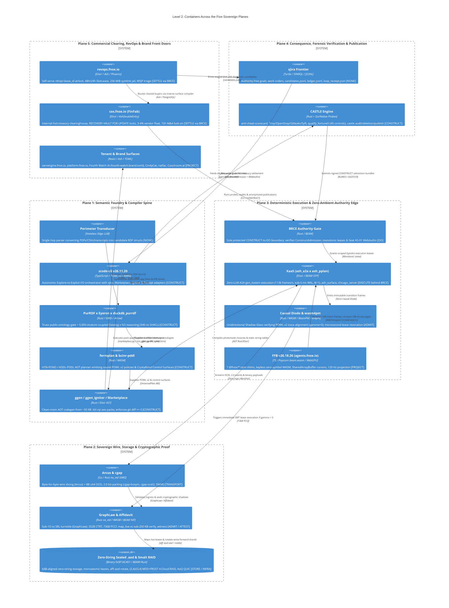
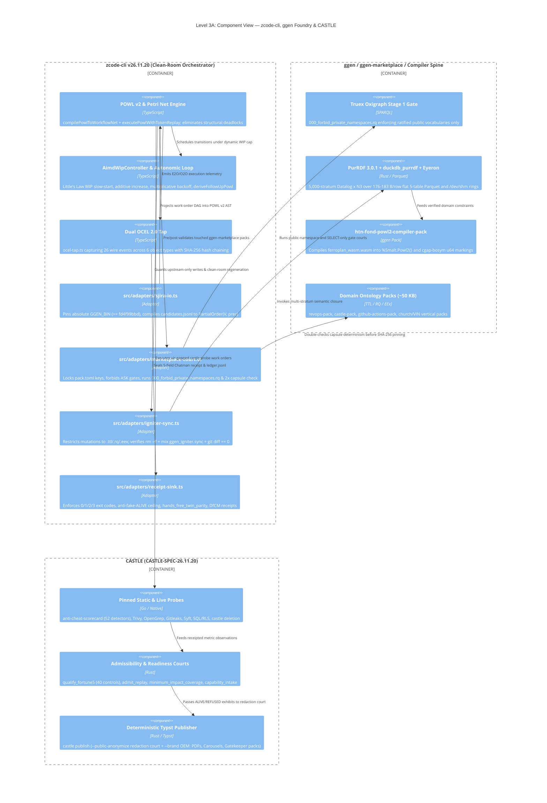
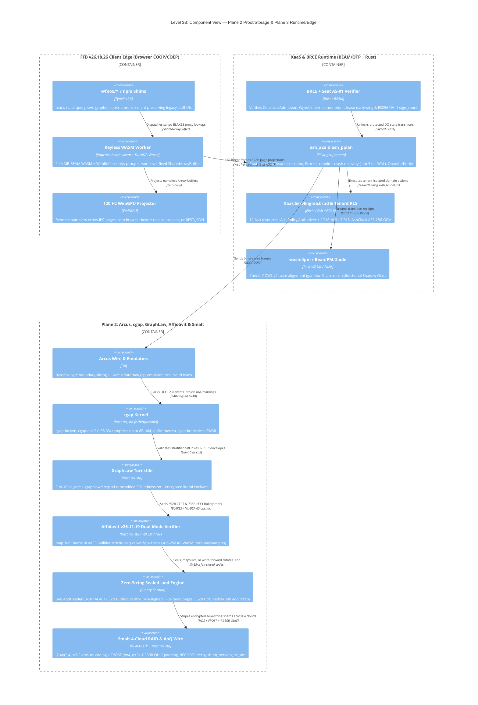

# C4 Architecture Model — Sovereign Ecosystem v26.11.20

Complete **C4 Architecture Model** (Levels 1–3 plus Deployment) spanning the **Sovereign Ecosystem v26.11.20** across all five architectural planes, repositories, web surfaces, and authority boundaries (`SELECT != CONSTRUCT != DO`), governed by the Chatman Conservation Law ($\Delta S_{\text{admitted}} + \mathbf{\Phi}_{\text{lease}} \equiv \mathbf{R}_{\text{receipt}} \pmod{\mathbf{\Sigma}_{\text{PQC}}}$).

---

## C4 Level 1: System Context Diagram

This view captures all human actors, external third-party platforms, and hardware trust anchors interacting with the Sovereign Ecosystem as a single boundary.



---

## C4 Level 2: Container Diagram (Five-Plane Architecture)

This view decomposes the ecosystem into its five architectural planes, showing the exact runtime containers, authority ceilings (`NONE`, `CONSTRUCT`, `ADMIT`, `ATTEST`, `DO`, `PROJECT`, `SETTLE`), and data-plane contracts.



---

## C4 Level 3A: Component Diagram — Autonomous Foundry & Verification Loop (Planes 1 & 4)

This view zooms into how `zcode-cli v26.11.20` closes the hands-free I/O loop across `sJira`, `ggen-marketplace`, `ggen_igniter`, `ferroplan`, and `CASTLE`.



---

## C4 Level 3B: Component Diagram — Sovereign Wire, Storage, Runtime & Protected DO Edge (Planes 2 & 3)

This view details the zero-string storage, cryptographic proof, BEAM photolithography, and keyless FFB edge components.



---

## C4 Deployment Diagram: Physical & Cloud Topology

This view maps every active repository, live production surface, local production-parity twin, and zero-custody client infrastructure node onto its execution environment.

```mermaid
C4Deployment
  title Deployment View — Local Foundry, Live GCP Run, Client 4-Cloud RAID & Air-Gapped Edge

  Deployment_Node(dev_mac, "Solo-Architect Foundry Host (macOS / Local Canonical Checkouts)", "Rust / Elixir OTP 28 / Go / Node") {
    Container(repos_core, "Core Foundry Repos", "~/fnox (13 TF roots), ~/ggen-marketplace, ~/cgap, ~/arcus, ~/smalt, ~/xaas, ~/srve, ~/cindy", "7-Stage Multi-Agent Manufacturing Loop, zcode-cli, ggen, CASTLE, local gcp_emulator & servengine_sim")
  }

  Deployment_Node(gcp_fnox, "FNOX Control & Live Production (GCP us-west1 / Cloud Run)", "Terraform-Managed (14 Offline-Verified Roots)") {
    Container(cr_srve, "servengine.fnox.io & platform.fnox.io", "Cloud Run (xaas-00022-8f6) + PG16 RLS", "Live XaaS + ServEngine React frontend, Secret Manager, OCEL v2 Cloud Logging")
    Container(cr_revops, "revops.fnox.io", "Cloud Run (infra/gcp/revops)", "Self-serve /drop/:lease_id intake airlock & WSJF prospect pipeline")
    Container(cr_cos, "cos.fnox.io (FinFab)", "Cloud Run (infra/gcp/cos)", "Sovereign HoldCo treasury ledger & Tableau recovery waterfall")
    Container(cr_ffb, "agents.fnox.io", "Cloud Run / Edge", "FFB v26.18.26 GA distribution & /.well-known/agent-card.json (<= 10 KB)")
  }

  Deployment_Node(client_raid, "Client-Owned 4-Cloud Hyperscaler RAID (Client EIN & Billing)", "0% FNOX Custody | 0.00% Transaction Rent") {
    Deployment_Node(aws, "AWS Account", "Shard Node 1") {
      ContainerDb(s1, "Smalt Shard + .aod", "MDS (2,4)/(3,4) + FROST", "Zero-string erasure-coded shard")
    }
    Deployment_Node(azure, "Azure Account", "Shard Node 2") {
      ContainerDb(s2, "Smalt Shard + .aod", "MDS (2,4)/(3,4) + FROST", "Zero-string erasure-coded shard (also Courtroom.ai host)")
    }
    Deployment_Node(gcp_c, "GCP Account", "Shard Node 3") {
      ContainerDb(s3, "Smalt Shard + .aod", "MDS (2,4)/(3,4) + FROST", "Zero-string erasure-coded shard")
    }
    Deployment_Node(oci, "OCI Account", "Shard Node 4") {
      ContainerDb(s4, "Smalt Shard + .aod", "MDS (2,4)/(3,4) + FROST", "Zero-string erasure-coded shard")
    }
  }

  Deployment_Node(client_browser, "Client Staff Browser", "COOP: same-origin | COEP: require-corp") {
    Container(ffb_edge, "FFB Keyless WASM Shell", "Popcorn beam.wasm + DuckDB-Wasm + WebGPU", "Wraps legacy SaaS/React UIs at 120 Hz over WebTransport h3")
  }

  Deployment_Node(auditor_host, "Air-Gapped Gatekeeper / Insurer Host", "Zero Network Egress") {
    Container(wasm_aud, "Affidavit Micro-Verifier", "Standalone sub-250 KB WASM", "Offline verify_witness over 352B CTRT & 736B PCCf fossils")
  }

  Rel(repos_core, gcp_fnox, "Deploys clean-room builds & verified TF plans", "Artifact Registry / Terraform")
  Rel(repos_core, client_raid, "Provisions client RAID cells in under 20 min", "Arcus / Terraform")
  Rel(client_browser, gcp_fnox, "Connects FFB shims to live XaaS", "WebTransport h3 (AOQ1)")
  Rel(client_browser, client_raid, "Connects FFB shims to sovereign RAID cells", "1,350B Isochronous AoQ QUIC :443")
  Rel(gcp_fnox, auditor_host, "Publishes anonymized gatekeeper-pack exhibits", "Offline Transfer (Zero PII)")
```

---

## Complete Project & Repository Inventory Mapped to C4 Planes

| Project / Repo / Surface | Local Path / Domain | Runtime / Stack | C4 Plane | Core Responsibility & Authority Ceiling |
| --- | --- | --- | --- | --- |
| **zcode-cli** | `zcode-cli` (`bin/zcode.js`) | TypeScript / POWL v2 / OCEL 2.0 | Plane 1 | Clean-room Explore-to-Exploit I/O orchestrator with sJira, Marketplace, Igniter & Receipt adapters (`CONSTRUCT`) |
| **ggen / ggen_igniter** | `ggen`, `ggen_igniter ~> 26.10.5` | Rust / Elixir AST (Igniter/Sourceror) | Plane 1 | AOT clean-room codegen from `.ttl`/`.rq`/`.eex` packs; enforces `git diff --exit-code == 0` (`CONSTRUCT`) |
| **ggen-marketplace** | `~/ggen-marketplace` | Turtle / SPARQL / Python check harness | Plane 1 | Qualified ~50 KB vertical packs (`revops-pack`, `castle-pack`, `htn-fond-powl2-compiler-pack`, `github-actions-pack`) (`CONSTRUCT`) |
| **Truex** | `000_forbid_private_namespaces.rq` | Oxigraph SPARQL | Plane 1 | Public-ontology-only Stage 1 build gate (FIBO, PROV-O, P-PLAN, SHACL, ODRL, OCEL v2) (`ADMIT`) |
| **PurRDF + duckdb_purrdf + Eyeron** | `PurRDF 3.0.1`, `Eyeron 0.8.18` | Rust / SIMD / Arrow / Parquet | Plane 1 | Coupled 5,000-stratum Datalog x N3 reasoning (340 ns SHACL, 176–183 B/row Parquet) (`CONSTRUCT`) |
| **ferroplan / bcinr-pddl** | `ferroplan_wasm.wasm`, `bcinr-pddl` | Rust / WASM | Plane 1 | AOT HTN-FOND / HDDL-PDDL planner compiling POWL v2 policies & Crystallized Control Surfaces (`CONSTRUCT`) |
| **Arcus** | `~/arcus` | Go + Terraform | Plane 2 | Byte-for-byte wire slicing + production-parity local cloud twins (`internal/gcp_emulator`) (`TRANSPORT`) |
| **cgap** | `/Users/sac/cgap` | Rust `#![no_std]` `#![forbid(unsafe_code)]` | Plane 2 | `cgap-bosym`, `cgap-ocel2` (~98.3% compression to 8B `u64`, >12M rows/s), `cgap-branchless` SWAR (`TRANSPORT/STORE`) |
| **GraphLaw** | `graphlaw/src/pccf.rs`, `ash_graphlaw` | Rust `#![no_std]` / Elixir | Plane 2 | Sub-10 ns semantic-law ingress turnstile, stratified SRL admission, encrypted literal enclaves (`ADMIT`) |
| **Affidavit / strata** | `affi` CLI, `ash_affidavit`, `strata` | Rust `#![no_std]` / WASM / BEAM NIF | Plane 2 | Zero-String `.aod` (`0x9F1AC401`), 352B CTRT, 736B PCCf, `map_live` vs `< 250 KB` `verify_witness` (`ATTEST`) |
| **Smalt** | `~/smalt` | BEAM/OTP + Rust `#![no_std]` | Plane 2 | 4-Cloud Hyperscaler RAID (AWS/Azure/GCP/OCI), 1,350B AoQ QUIC + RFC 9266 decoy, `servengine_sim` (`INFRASTRUCTURE`) |
| **BRCE** | Core boundary + Seat AS-01 | Rust / BEAM / WebAuthn ES256 | Plane 3 | Sole protected `CONSTRUCT -> DO` boundary enforcing hardware UV seals & monotonic leases (`DO`) |
| **XaaS** | `~/xaas` (`ash_a2a`, `ash_pplan`, `ash_surface`, `chicago_server`) | Elixir / BEAM OTP 28 | Plane 3 | Zero-LLM A2A `gen_statem` runtime (113k frames/s, < 5 ms WAL, B=1), tenant CRUD + PG16 RLS (`EXECUTE behind BRCE`) |
| **wasm4pm / BeamPM / ex4pm** | Strict Causal Diode court | Rust WASM / Elixir | Plane 3 | Live POWL v2 trace alignment ($\gamma = 0$) revoking SMT leases in microseconds on divergence (`ADMIT`) |
| **FFB v26.18.26** | `@fnox/*` (7 npm shims), `agents.fnox.io` | TS / Popcorn `beam.wasm` / WebGPU | Plane 3 | Keyless, zero-REST, zero-symbol 120 Hz SaaS wrappers over WebTransport `h3` & `SharedArrayBuffer` (`PROJECT`) |
| **sJira** | `docs/sjira/`, `candidates.jsonl` | Turtle / SPARQL / JSONL | Plane 4 | Authority-free goals, obligations, eligible frontier, and append-only execution ledger (`NONE`) |
| **CASTLE** | `castle` CLI + `anti-cheat-scorecard` | Rust / Typst + Go/Native Probes | Plane 4 | 40-control Fortune-5 court, Claims vs Code, 45-day CPRA deletion tracker, `--public-anonymize --brand` publisher (`CONSTRUCT`) |
| **fnox Core Infra** | `~/fnox` | Terraform (13 roots) / Python offline harness | Plane 5 | Offline-verified GCP Terraform roots, `epistemic.py` `MonotonicLease`, `ledger/core.py` (`INFRASTRUCTURE`) |
| **RevOps Airlock** | `revops.fnox.io` (`infra/gcp/revops`) | Elixir / Ash / Phoenix | Plane 5 | `/drop/:lease_id` intake, Edge-Shell Clock `SlotLease`, 256 MiB jail, 21k LinkedIn WSJF triage (`SETTLE via BRCE`) |
| **FinFab / HoldCo OS** | `cos.fnox.io` | Elixir / `AshDoubleEntry` | Plane 5 | Internal Fed clearinghouse, `RECOVERY-VAULT` locks, 4-tier $10^k$ scaling, 3–4% Kudzu float, 72h M&A (`SETTLE via BRCE`) |
| **ServEngine & Platform** | `servengine.fnox.io`, `platform.fnox.io`, `~/srve/servengine-frontend` | React + XaaS on GCP Cloud Run | Plane 5 | Live multi-entity dispatch/CRUD production tenant proving FFB + PG16 RLS + OCEL v2 (`PROJECT`) |
| **Fourth Watch AI** | `fourth-watch.brand.toml` | TOML Brand Pack + CASTLE/FFB | Plane 5 | Active Hard-intake cybersecurity front door (Faith + AI: Sentinel, Steward, Shepherd) (`PROJECT`) |
| **CindyCat** | `cindycat.com`, `~/cindy` (`wf_0e714c3d-13a`) | Civic/Church `ggen` Pack + RAID | Plane 5 | Shelved Soft-intake civic/church patronage & §107/§127 guild pending Fourth Watch cash compounding (`PROJECT`) |
| **Other Vertical Tenants** | `natfac`, `Courtroom.ai`, Woz & Jobs OEM | `ggen`-synthesized / Azure & 4-Cloud | Plane 5 | Isomorphic vertical deployments & Depth-1 wholesale OEM partner fronts (`PROJECT`) |
