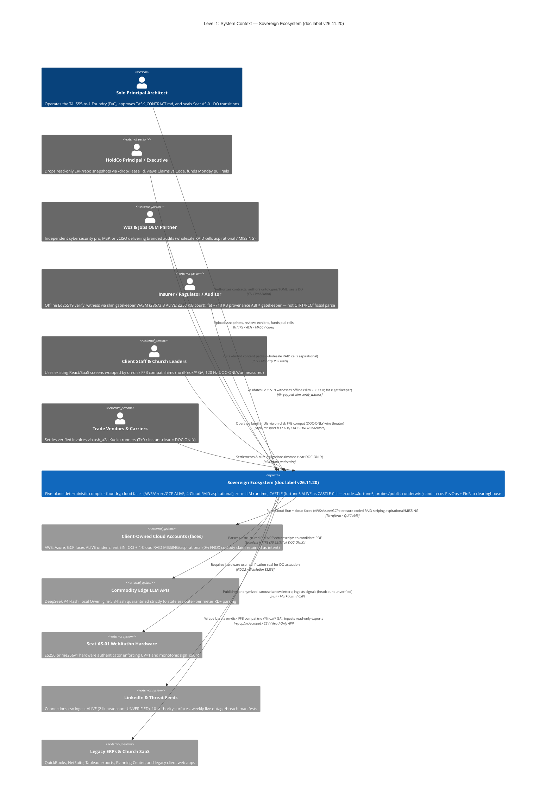
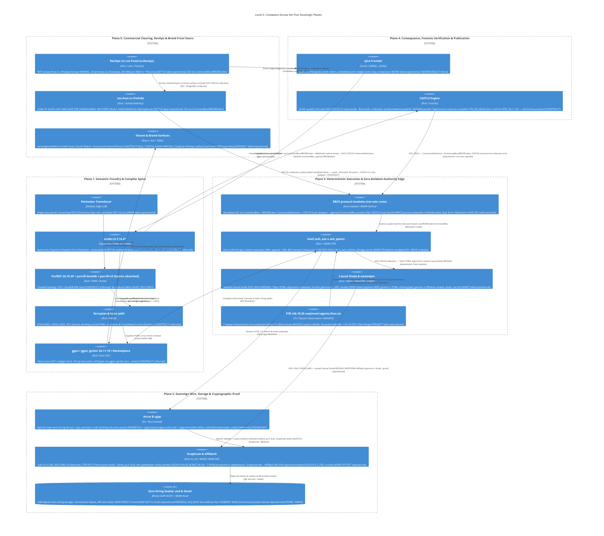
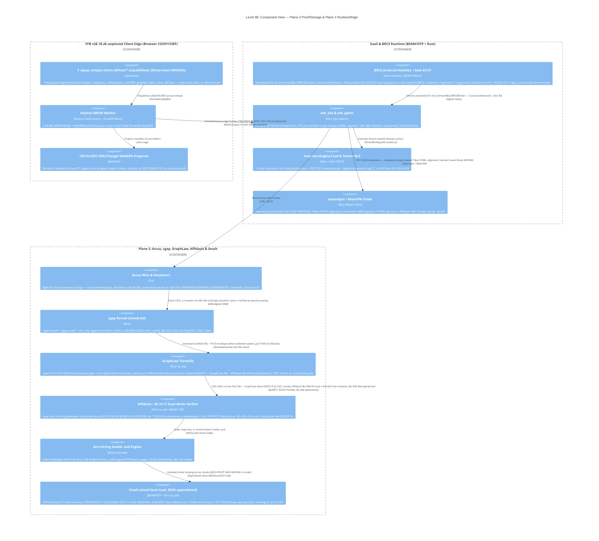

# C4 Architecture Model — Sovereign Ecosystem (doc label v26.11.20)

Complete **C4 Architecture Model** (Levels 1–3 plus Deployment) spanning the Sovereign Ecosystem under **doc wave label `v26.11.20`** (not a matched monorepo/package pin) across all five architectural planes, repositories, web surfaces, and authority boundaries (`SELECT != CONSTRUCT != DO`). The Chatman Conservation Law ($\Delta S_{\text{admitted}} + \mathbf{\Phi}_{\text{lease}} \equiv \mathbf{R}_{\text{receipt}} \pmod{\mathbf{\Sigma}_{\text{PQC}}}$) is **DOC-ONLY / aspirational** — not a live governing modulus; **production $\mathbf{\Sigma}_{\text{PQC}}$ is unmet** (scheme unset / Ed25519-path refusals elsewhere). Fuel-style conservation, where referenced, lives in strata_protocol scratch only — not a sealed product gate.

> **Version honesty:** `v26.11.20` = doc/wave label only. On-disk pins: **zcode-cli `package.json` `3.14.4-1`** (diagrams may show `3.14.4*`); **PurRDF `26.10.29`** (not `3.0.1`); **Eyeron absorbed into `purrdf-n3` — no live `0.8.18` pin**; **`ggen_igniter` `26.11.18`** (not `~>26.10.5` as sole truth).

---

## C4 Level 1: System Context Diagram

This view captures all human actors, external third-party platforms, and hardware trust anchors interacting with the Sovereign Ecosystem as a single boundary.

> **L1 / Deploy packaging truth (lane 2):** AWS / Azure / GCP **faces ALIVE** (`~/arcus/arcus.toml` `[faces.aws|azure|gcp]`). **4-Cloud RAID + OCI = MISSING / aspirational** (no OCI face; no striped RAID substrate on disk). **MDS / FROST RAID = not in `~/smalt`**. FFB packaging = **7 repo-local `repop` compat shims** (former `@fnox/*` names: useQuery, useMutation, useSWR, graphql, table, store, dbClient) — **not published npm**; **`@fnox/react` MISSING**. LinkedIn **Connections ingest ALIVE**; **21k headcount unverified**. AoQ QUIC **face** present; **1,350B Isochronous / RFC 9266 = aspirational** (not live product claim).



---

## C4 Level 2: Container Diagram (Five-Plane Architecture)

This view decomposes the ecosystem into its five architectural planes, showing the exact runtime containers, **enforced** authority fences (`OBSERVE` | `SELECT` | `CONSTRUCT`, with receipted `DO`), plus **aspirational / documented-only** phase labels (`NONE`, `ADMIT`, `ATTEST`, `PROJECT`, `SETTLE`) that are not a unified runtime enum.

> **Authority ceiling truth (lane 5):** Enforced on disk = `OBSERVE|SELECT|CONSTRUCT` fences (SHACL / PlanningEpisode / ExecutionPackage / Affidavit 4-rung) + receipted `DO` via `AshA2A.CommandBus` and `gymact.brce.BRCEBroker`. **`ConstructAdmission` EXISTS** as CASTLE-local opaque (`castle/src/castle.rs`) — **↛** AshA2A.CommandBus / gymact BRCEBroker product Rel (**not** a gymact/BRCE named type / 7-rung enum; CASTLE-local GymAct/BRCE journal underwire ≠ that wire). Lattice **`NONE/CONSTRUCT/ADMIT/ATTEST/DO/PROJECT/SETTLE` = DOC-ONLY / aspirational**. **BRCE = protocol host modules** (not a solo `brce` crate). Seat AS-01 WebAuthn remains ALIVE in cos.

> **L2 Plane4/5 truth (lane 6):** CASTLE — only `qualify_fortune5` (40 controls) **ALIVE** as a live product path (CASTLE CLI — **zcode↛fortune5**). `src/probes`, `src/deletion`, `src/publish` = **underwire** (on disk, not product ALIVE): **Typst is source-emit only** (no Typst compiler product), probes-manifest still has **`PIN_ON_BUILD` placeholders**, and **`CASTLE-SPEC-26.11.20` file is MISSING** — not a full live forensic/publishing product. RevOps is **in-cos** (`FnoxCos.Revops` under `~/fnox/cos`), **not** a `revops.fnox.io` surface; `infra/gcp/revops` is **MISSING**. Live `cos.fnox.io` is **FAKE-ALIVE** (`DB_UNAVAILABLE` despite TF/`/healthz`).



---

## C4 Level 3A: Component Diagram — Autonomous Foundry & Verification Loop (Planes 1 & 4)

This view zooms into how `zcode-cli 3.14.4*` orchestrates the Explore→Exploit I/O loop across `sJira`, `ggen-marketplace`, `ggen_igniter`, `ferroplan`, and (opt-in) `CASTLE` publish — not a sealed hands-free twin-parity product.

> **Rel honesty:** `zcode↛fortune5` (castle-publish `enabled=false`). `ConstructAdmission` **↛** CommandBus/BRCEBroker. `diode↛proof` DOC-ONLY OVERCLAIM. GraphLaw attest **Ed25519** (ML-DSA/Σ_PQC unmet). Arcus emulator **production-parity UNVERIFIED**. Twin pin (CREATE-4): `twin_parity_self_test_cmd=["true"]` → `hands_free` stub-armed only — not a product twin court.

```mermaid
C4Component
  title Level 3A: Component View — zcode-cli, ggen Foundry & CASTLE

  Container_Boundary(zcode_c, "zcode-cli 3.14.4* (Clean-Room Orchestrator)") {
    Component(powl_eng, "POWL v2 & Petri Net Engine", "TypeScript", "compilePowlToWorkflowNet + executePowlWithTokenReplay; eliminates structural deadlocks")
    Component(aimd, "AimdWipController & Autonomic Loop", "TypeScript", "Little's Law WIP slow-start, additive increase, multiplicative backoff, deriveFollowUpPowl")
    Component(ocel_tap, "Dual OCEL 2.0 Tap", "TypeScript", "ocel-tap.ts capturing 26 wire events across 6 object types with SHA-256 hash chaining")
    Component(ad_sjira, "src/adapters/sjira-io.ts", "Adapter", "Pins absolute GGEN_BIN (>= fd4f99bbd), compiles candidates.jsonl to PartialOrder(V, prec)")
    Component(ad_mkt, "src/adapters/marketplace-court.ts", "Adapter", "Locks pack.toml keys, forbids ASK gates, runs 000_forbid_private_namespaces.rq & 2x capsule check")
    Component(ad_ui_layout, "src/adapters/ui-layout-court.ts", "Adapter", "TransitionCourtAdapter name=ui-layout-court; TOML [adapters.ui_layout]; exit codes 0/1/2/3; spawns ggen-layout-court layout_court")
    Component(ad_ign, "src/adapters/igniter-sync.ts", "Adapter", "Restricts mutations to .ttl/.rq/.eex; verifies rm -rf + mix ggen_igniter.sync --check")
    Component(ad_castle, "src/adapters/castle-publish.ts", "Adapter", "OPT-IN underwire — [adapters.castle_publish] enabled=false default; CASTLE_PUBLISH_EXECUTE=1 for live invoke; redaction court only — zcode↛fortune5")
    Component(ad_sink, "src/adapters/receipt-sink.ts", "Adapter", "Enforces 0/1/2/3 exit codes, anti-fake-ALIVE standing; enforce_twin_parity + twin_parity_self_test_cmd=[\"true\"] pin → hands_free auto-armed (stub); DfCM receipts")
  }

  Container_Boundary(foundry_c, "ggen / ggen-marketplace / Compiler Spine") {
    Component(truex, "Truex whitelist (via cos)", "FnoxCos.Ontology.Whitelist", "Public-ontology admit hosted on cos.fnox.io; 000_forbid_private_namespaces.rq is cos gate payload, not an Oxigraph/rq host")
    Component(datalog_n3, "PurRDF 26.10.29 + purrdf-duckdb + purrdf-n3 (Eyeron absorbed)", "Rust / Parquet", "Coupled Datalog x N3 over 176-183 B/row flat 5-table Parquet and /dev/shm rings [5k-stratum DOC-ONLY]")
    Component(htn_pack, "htn-fond-powl2-compiler-pack", "ggen Pack", "Compiles ferroplan_wasm.wasm into %Smalt.Powl2{} and cgap-bosym u64 markings")
    Component(mobile_pack, "mobile-ui-layout-pack", "ggen Pack", "Zero-HITL mobile-first SHACL UI (shui: CCS); pack.toml + ontology.ttl + brand/fourth-watch.brand.toml + gates + spatial-court templates")
    Component(layout_court, "ggen-layout-court", "Rust / taffy", "AOT Flexbox/Grid bbox court (stay-in-bounds + pairwise non-overlap); metrics.rs + text_spacing.rs; bins layout_court / overflow_viewport_sweep")
    Component(spatial_court, "GgenIgniter.SpatialCourt", "Elixir", "Emits Playwright *.spatial-court.spec.ts from sh:PropertyGroup; viewport / overflow / touch / gap / Gestalt helpers")
    Component(brand_theme, "GgenIgniter.BrandTheme", "Elixir", "Emits Tailwind v4 @theme spacing CSS from DTCG-aligned *.brand.toml (theme_spacing.css.eex)")
    Component(packs, "Domain Ontology Packs", "TTL / RQ / EEx", "fde20-revops-pack, castle-board-pack, github-actions-pack, mobile-ui-layout-pack, church/VIN vertical packs (exact revops-pack/castle-pack MISSING; ~50KB DOC-ONLY)")
  }

  Container_Boundary(perim_c, "Perimeter UI DO Fence (figex)") {
    Component(figex_gate, "figex llm-tsx-actuation-gate", "Node / mjs", "Fail-closed quarantine for LLM→Tailwind/CSS .tsx writes; parks under .figex-llm-quarantine/; opt-in FIGEX_ALLOW_LLM_TSX; lawful path Plane 1 rdf-export")
  }

  Container_Boundary(castle_c, "CASTLE ~/castle (qualify_fortune5 ALIVE as CLI; zcode↛fortune5; SPEC MISSING; not full live product)") {
    Component(probes, "Pinned Static & Live Probes [underwire; PIN_ON_BUILD]", "Go / Native / Rust", "src/probes underwire on disk; configs/probes-manifest.json still has PIN_ON_BUILD placeholders — pins unresolved; not zcode Rel")
    Component(courts, "Admissibility & Readiness Courts [ALIVE: fortune5 CLI]", "Rust", "qualify_fortune5 (40 controls) ALIVE via CASTLE CLI fortune5 qualify only — not zcode; admit_replay, minimum_impact_coverage, capability_intake present")
    Component(publisher, "Deterministic Typst Publisher [underwire; Typst-source only]", "Rust / Typst-source", "src/publish + src/deletion underwire; emits Typst source only (no Typst compiler); CASTLE-SPEC-26.11.20 file MISSING")
  }

  Rel(ad_sjira, powl_eng, "Projects work-order DAG into POWL v2 AST")
  Rel(powl_eng, aimd, "Schedules transitions under dynamic WIP cap")
  Rel(powl_eng, ocel_tap, "Emits E2O/O2O execution telemetry")
  Rel(powl_eng, ad_mkt, "Pre/post-validates touched ggen-marketplace packs")
  Rel(ad_mkt, truex, "Runs public-namespace and SELECT-only gate courts")
  Rel(ad_mkt, packs, "Double-checks capsule determinism before SHA-256 pinning")
  Rel(ad_mkt, mobile_pack, "Qualifies mobile-ui-layout-pack capsule & gates")
  Rel(powl_eng, ad_ui_layout, "Runs UI layout TransitionCourt (registry [adapters.ui_layout])")
  Rel(ad_ui_layout, layout_court, "Spawns cargo -p ggen-layout-court --bin layout_court on subject JSON")
  Rel(spatial_court, mobile_pack, "mix ggen_igniter.spatial_court --ontology from pack SHACL / PropertyGroup graph")
  Rel(brand_theme, mobile_pack, "mix ggen_igniter.brand_theme --brand pack brand/fourth-watch.brand.toml")
  Rel(powl_eng, ad_ign, "Guards upstream-only writes & clean-room regeneration")
  Rel(ad_ign, datalog_n3, "Invokes multi-stratum semantic closure")
  Rel(datalog_n3, htn_pack, "Feeds verified domain constraints")
  Rel(powl_eng, ad_castle, "OPT-IN underwire castle-publish when enabled=true (default false) — zcode↛fortune5")
  Rel(powl_eng, probes, "DOC-ONLY/aspirational from zcode [no fortune5 court; probes underwire; PIN_ON_BUILD unresolved]")
  Rel(probes, courts, "underwire metric feed [pins/SPEC incomplete]; fortune5 qualify is CASTLE CLI — zcode↛fortune5")
  Rel(courts, publisher, "CASTLE-local standing → Typst-source publish underwire only [SPEC MISSING; not PDF product; not invented ALIVE]")
  Rel(ocel_tap, ad_sink, "Writes flat cycle stub / loop_receipt (not Chatman-5) & ledger.jsonl; twinParity.hands_free auto-armed via twin_parity_self_test_cmd=[\"true\"] pin (stub court)")
```

---

## C4 Level 3B: Component Diagram — Sovereign Wire, Storage, Runtime & Protected DO Edge (Planes 2 & 3)

This view details the zero-string storage, cryptographic proof, BEAM photolithography, and keyless FFB edge components.



---

## C4 Deployment Diagram: Physical & Cloud Topology

This view maps every active repository, live production surface, local cloud-twin code (Arcus `gcp_emulator` ALIVE; **production-parity UNVERIFIED**), and zero-custody client infrastructure node onto its execution environment.

> **Twin / parity honesty:** Arcus emulator ≠ sealed production-parity (**UNVERIFIED**). CREATE-4 pin: `twin_parity_self_test_cmd=["true"]` → `twinParity.hands_free` stub-armed only (not a product ALIVE twin court).

> **Deploy packaging truth:** Keep **AWS / Azure / GCP** faces. Treat **4-Cloud RAID / OCI** and **MDS+FROST striping** as **MISSING / aspirational** (not in `~/smalt`). FFB edge packaging = **7 `~/repop` compat shims**, not published `@fnox/*`; **`@fnox/react` MISSING**. **1,350B Isochronous AoQ QUIC = aspirational** (AoQ face without live 1350/9266 product). Arcus `gcp_emulator` **code ALIVE**; **production-parity UNVERIFIED**.

```mermaid
C4Deployment
  title Deployment View — Local Foundry, Live GCP Run, Client Cloud Faces (RAID aspirational) & Air-Gapped Edge

  Deployment_Node(dev_mac, "Solo-Architect Foundry Host (macOS / Local Canonical Checkouts)", "Rust / Elixir OTP 28 / Go / Node") {
    Container(repos_core, "Core Foundry Repos", "~/fnox (14 TF roots), ~/ggen-marketplace, ~/cgap, ~/arcus, ~/smalt, ~/xaas, ~/srve, ~/cindy, ~/repop", "7-Stage Multi-Agent Manufacturing Loop, zcode-cli, ggen, CASTLE, gcp_emulator code ALIVE (production-parity UNVERIFIED) & servengine_sim; FFB compat under repop")
  }

  Deployment_Node(gcp_fnox, "FNOX Control & Live Production (GCP us-west1 / Cloud Run)", "Terraform-Managed (14 Offline-Verified Roots)") {
    Container(cr_srve, "servengine.fnox.io & platform.fnox.io", "Cloud Run (xaas-00022-8f6) + PG15 RLS", "Live XaaS + ServEngine React frontend, Secret Manager, OCEL v2 Cloud Logging")
    Container(cr_revops, "RevOps (in-cos)", "FnoxCos.Revops — NOT revops.fnox.io; infra/gcp/revops MISSING", "/drop/:lease_id + SlotLease + WSJF served by cos Cloud Run, not a separate TF root")
    Container(cr_cos, "cos.fnox.io (FinFab)", "Cloud Run (infra/gcp/cos) LIVE FAKE-ALIVE", "TF authored; /healthz up; DB_UNAVAILABLE — treasury/drop not production-ready")
    Container(cr_ffb, "agents.fnox.io", "Cloud Run / Edge", "FFB v26.18.26 unpinned; 7 repop compat shims (not published @fnox/*; @fnox/react MISSING) & /.well-known/agent-card.json (<= 10 KB)")
  }

  Deployment_Node(client_faces, "Client-Owned Cloud Faces (Client EIN & Billing) — RAID MISSING/aspirational", "0% FNOX Custody intent | AWS/Azure/GCP faces ALIVE in Arcus") {
    Deployment_Node(aws, "AWS Account", "Face ALIVE (arcus [faces.aws])") {
      ContainerDb(s1, "Intended .aod / Smalt host", "face only", "No MDS/FROST RAID stripe in smalt")
    }
    Deployment_Node(azure, "Azure Account", "Face ALIVE (arcus [faces.azure])") {
      ContainerDb(s2, "Intended .aod / Smalt host", "face only", "No MDS/FROST RAID stripe in smalt (also Courtroom.ai host intent)")
    }
    Deployment_Node(gcp_c, "GCP Account", "Face ALIVE (arcus [faces.gcp])") {
      ContainerDb(s3, "Intended .aod / Smalt host", "face only", "No MDS/FROST RAID stripe in smalt")
    }
    Deployment_Node(oci, "OCI Account", "MISSING / aspirational") {
      ContainerDb(s4, "No OCI face on disk", "MISSING", "4th RAID node not provisioned; aspirational only")
    }
  }

  Deployment_Node(client_browser, "Client Staff Browser", "COOP: same-origin | COEP: require-corp") {
    Container(ffb_edge, "FFB Keyless WASM Shell", "Popcorn beam.wasm + DuckDB-Wasm + WebGPU", "Wraps legacy SaaS/React UIs via 7 repop compat shims (not published @fnox/*; @fnox/react MISSING)")
  }

  Deployment_Node(auditor_host, "Air-Gapped Gatekeeper / Insurer Host", "Zero Network Egress") {
    Container(wasm_aud, "Affidavit Micro-Verifier", "affidavit-gatekeeper-wasm 28673 B", "Offline Ed25519 verify_witness (slim ALIVE); fat affidavit-wasm 718736 B = provenance ABI ≠ gatekeeper; not CTRT/PCCf fossil parse")
  }

  Rel(repos_core, gcp_fnox, "Deploys clean-room builds & verified TF plans", "Artifact Registry / Terraform")
  Rel(repos_core, client_faces, "Provisions cloud faces (RAID cells aspirational/MISSING)", "Arcus faces / Terraform")
  Rel(client_browser, gcp_fnox, "Connects on-disk FFB compat modules to live XaaS (wire DOC-ONLY)", "WebTransport h3 / AOQ1 DOC-ONLY/underwire")
  Rel(client_browser, client_faces, "Intended sovereign RAID path (MISSING in smalt)", "AoQ QUIC face; 1,350B Isochronous + RFC 9266 aspirational (not live)")
  Rel(gcp_fnox, auditor_host, "Publishes anonymized gatekeeper-pack exhibits", "Offline Transfer (Zero PII)")
```

---

## On-disk version pins (lane 1)

Program umbrella title `v26.11.20` is **not** a package pin. Package claims below match disk (audit was 0/6 MATCH before this truth-up).

| Component | On-disk / doc pin | Standing | Source |
| --- | --- | --- | --- |
| zcode-cli | `3.14.4*` (package.json `3.14.4-1`) | **ALIVE pin** | `zcode-cli/package.json` |
| PurRDF | `26.10.29` (`purrdf-duckdb`, `purrdf-n3`) | **ALIVE pin** | `~/purrdf/Cargo.toml` |
| Eyeron | absorbed into `purrdf-n3` | **no live pin** | `~/purrdf/crates/n3` |
| ggen_igniter | `26.11.18` | **ALIVE pin** | `~/ggen_igniter/mix.exs` |
| Affidavit / `affi` | `~26.10.17` | **ALIVE pin** | `~/affidavit/Cargo.toml` |
| CASTLE-SPEC | `CASTLE-SPEC-26.11.20` | **file MISSING** | no `CASTLE-SPEC*` under `~/castle` |
| FFB | `v26.18.26 unpinned` | **unpinned** | no on-disk pin; label retained |
| XaaS / ServEngine Postgres | **PG15** (`pgvector/pgvector:pg15`) | **ALIVE pin** | `xaas/compose.yaml` |

---

## Complete Project & Repository Inventory Mapped to C4 Planes

| Project / Repo / Surface | Local Path / Domain | Runtime / Stack | C4 Plane | Core Responsibility & Authority (enforced: OBSERVE\|SELECT\|CONSTRUCT + receipted DO; 7-rung labels aspirational) |
| --- | --- | --- | --- | --- |
| **zcode-cli** | `zcode-cli 3.14.4*` (`bin/zcode.js`; on-disk `package.json` `3.14.4-1`) | TypeScript / POWL v2 / OCEL 2.0 | Plane 1 | Clean-room Explore-to-Exploit I/O orchestrator with sJira, Marketplace, Igniter, Receipt & `ui-layout-court` adapters; **zcode↛fortune5** (castle-publish OPT-IN underwire `enabled=false`; fortune5 ALIVE as CASTLE CLI only) (`CONSTRUCT`) |
| **ui-layout-court** | `zcode-cli/src/adapters/ui-layout-court.ts` (`[adapters.ui_layout]`) | TypeScript `TransitionCourtAdapter` | Plane 1 | UI layout TransitionCourt (exit 0/1/2/3); spawns `ggen-layout-court` `layout_court`; chicago suite on disk (`CONSTRUCT`) |
| **ggen / ggen_igniter** | `ggen`, `ggen_igniter 26.11.18` | Rust / Elixir AST (Igniter/Sourceror) | Plane 1 | AOT clean-room codegen from `.ttl`/`.rq`/`.eex` packs; drift gate `mix ggen_igniter.sync --check`; hosts `SpatialCourt` / `BrandTheme` mix tasks (`CONSTRUCT`) |
| **ggen-layout-court** | `ggen/crates/ggen-layout-court` | Rust / taffy (`#![no_std]`+alloc) | Plane 1 | AOT Flexbox/Grid bbox court — stay-in-bounds + pairwise non-overlap; `metrics.rs` + `text_spacing.rs`; bins `layout_court` / `overflow_viewport_sweep` (`CONSTRUCT`) |
| **SpatialCourt + BrandTheme** | `ggen_igniter/lib/ggen_igniter/{spatial_court,brand_theme}.ex` | Elixir (+ mix tasks) | Plane 1 | `SpatialCourt` emits Playwright `*.spatial-court.spec.ts` from `sh:PropertyGroup`; `BrandTheme` emits Tailwind v4 `@theme` CSS from DTCG `*.brand.toml` (`CONSTRUCT`) |
| **ggen-marketplace** | `~/ggen-marketplace` | Turtle / SPARQL / Python check harness | Plane 1 | Qualified vertical packs on disk: `fde20-revops-pack`, `castle-board-pack`, `htn-fond-powl2-compiler-pack`, `github-actions-pack`, `mobile-ui-layout-pack`; exact `revops-pack`/`castle-pack` **MISSING** (near-misses: `ash-revops-structural-factory-pack`, `ash-ocel-revops-surface-factory-pack`, `castle-changelog-release-pack`, `xaas-castle-bridge-pack`) (`CONSTRUCT`) |
| **mobile-ui-layout-pack** | `ggen-marketplace/packs/mobile-ui-layout-pack` | TTL / RQ / EEx / brand.toml | Plane 1 | Zero-HITL mobile-first SHACL UI pack (`shui:` CCS); `ontology.ttl`, `gates/*.rq`, `brand/fourth-watch.brand.toml`, spatial-court templates (`CONSTRUCT`) |
| **Truex** | hosted via `cos.fnox.io` (`FnoxCos.Ontology.Whitelist`; query twin `priv/ontologies/queries/000_forbid_private_namespaces.rq`) | Elixir / cos (not Oxigraph rq host) | Plane 1 | Public-ontology whitelist gates (FIBO, PROV-O, P-PLAN, SHACL, ODRL, OCEL v2); cos hosts, `.rq` is payload (`ADMIT` label aspirational) |
| **PurRDF + purrdf-duckdb + purrdf-n3** | `PurRDF 26.10.29` (`purrdf-duckdb`, `purrdf-n3`; Eyeron lineage absorbed, no live Eyeron pin) | Rust / SIMD / Arrow / Parquet | Plane 1 | Coupled Datalog x N3 + DuckDB RDF eval (176–183 B/row Parquet); 5,000-stratum / 340 ns SHACL **DOC-ONLY** (`CONSTRUCT`) |
| **ferroplan / bcinr-pddl** | `ferroplan_wasm.wasm`, `bcinr-pddl` | Rust / WASM | Plane 1 | AOT HTN-FOND / HDDL-PDDL planner compiling POWL v2 policies & Crystallized Control Surfaces (`CONSTRUCT`) |
| **figex llm-tsx quarantine** | `dis/figex/src/lib/llm-tsx-actuation-gate.mjs` | Node / mjs | Plane 1 perimeter | Fail-closed fence for LLM→Tailwind/CSS `.tsx` writes; parks under `.figex-llm-quarantine/`; opt-in `FIGEX_ALLOW_LLM_TSX`; lawful UI path `rdf-export` (`NONE` DO refuse) |
| **Arcus** | `~/arcus` | Go + Terraform | Plane 2 | Byte-for-byte wire slicing + `internal/gcp_emulator` **code ALIVE**; **production-parity UNVERIFIED** vs real GCP (`KNOWN_DIVERGENCES`, `binauthz_cloudrun.tf`) (`TRANSPORT`) |
| **cgap** | `/Users/sac/cgap` | Rust mixed: **only `cgap-branchless`** is `#![no_std]` `#![forbid(unsafe_code)]`; **`cgap-bosym` / `cgap-ocel2` = std** | Plane 2 | `cgap-bosym`, `cgap-ocel2` (8B `u64` OCEL packing; ~98.3% / >12M rows/s **DOC-ONLY**), `cgap-branchless` SWAR (`TRANSPORT/STORE`) |
| **GraphLaw** | `graphlaw/src/pccf.rs`, `ash_graphlaw` | Rust `#![no_std]` / Elixir | Plane 2 | Sub-10 ns semantic-law ingress turnstile **DOC-ONLY/unmeasured**; `admit_pccf` **FAKE-ALIVE/stub** (`NotImplemented`); 736B parse fence ALIVE; encrypted literal enclaves; **Rel→Affidavit ML-DSA = DOC-ONLY/aspirational** (GraphLaw production attest **Ed25519**; $\mathbf{\Sigma}_{\text{PQC}}$ unmet on GraphLaw path) (`ADMIT` label aspirational) |
| **Affidavit / strata** | `affi` CLI ~26.10.17, `ash_affidavit`, `strata` | Rust `#![no_std]` / WASM / BEAM NIF | Plane 2 | Zero-String `.aod`; CTRT/PCCf **frame parse** ALIVE; slim gatekeeper `verify_witness` **Ed25519 ALIVE @28673 B** (≤250 KiB court); fat ~718 KB provenance ABI ≠ gatekeeper / **not** fossil-parse product; GraphLaw Rel modulus stays Ed25519 (`ATTEST` aspirational) |
| **Smalt** | `~/smalt` | BEAM/OTP + Rust `#![no_std]` | Plane 2 | Cloud faces via Arcus (AWS/Azure/GCP **ALIVE**); **4-Cloud RAID / OCI / MDS+FROST NOT in smalt** (MISSING/aspirational); AoQ QUIC **face** without live **1,350B Isochronous / RFC 9266** (those aspirational); `servengine_sim` (`INFRASTRUCTURE`) |
| **BRCE** | Protocol host modules (not solo crate) + Seat AS-01 | `gymact` BRCEBroker / `AshA2A.CommandBus` / WebAuthn ES256 | Plane 3 | Receipted `DO` via CommandBus/BRCEBroker ALIVE where wired; `ConstructAdmission` **↛** that product Rel (CASTLE-local opaque; in-crate GymAct/BRCE journal underwire ≠ gymact named type / 7-rung enum; lattice DOC-ONLY/aspirational); UV seals where wired |
| **XaaS** | `~/xaas` (`ash_a2a`, `ash_pplan`, `ash_surface`, `chicago_server`) | Elixir / BEAM OTP 28 | Plane 3 | Zero-LLM A2A `gen_statem` runtime (WAL append ~29k–88k frames/s measured; 113k frames/s **DOC-ONLY**; B=1), tenant CRUD + PG15 RLS (`EXECUTE behind BRCE`; compose `pgvector/pgvector:pg15`) |
| **wasm4pm / BeamPM / ex4pm** | Causal Diode / BeamPM court | Rust WASM / Elixir | Plane 3 | Named **Causal Diode DOC-ONLY/MISSING**; *4pm POWL alignment underwire; **diode↛proof OVERCLAIM** (former γ>0→SMT/PCCf revoke); cognition MDP `gamma` ≠ POWL choice-graph `gamma` ≠ Affidavit revoke (`ADMIT` label aspirational) |
| **FFB v26.18.26 (unpinned)** | `agents.fnox.io` + `~/repop/packages/repop/src/compat` (**7** shims; not published `@fnox/*`; **`@fnox/react` MISSING**; no on-disk pin found) | TS / Popcorn `beam.wasm` / WebGPU | Plane 3 | Repo-local compat modules only (useQuery, useMutation, useSWR, graphql, table, store, dbClient); WebTransport `h3` / 16B·28B·64B AOQ1 wire **DOC-ONLY/underwire**; SharedArrayBuffer local (`PROJECT` label aspirational) |
| **sJira** | `docs/sjira/`, `candidates.jsonl` | Turtle / SPARQL / JSONL | Plane 4 | Authority-free goals, obligations, eligible frontier, and append-only execution ledger (`NONE` label aspirational) |
| **CASTLE** | `~/castle` CLI; **CASTLE-SPEC-26.11.20 file MISSING** | Rust (+ underwire probes/deletion/publish) | Plane 4 | **ALIVE:** `qualify_fortune5` (40) CASTLE CLI only (**zcode↛fortune5**). **underwire:** probes (`PIN_ON_BUILD`), deletion, publish (**Typst-source only**, no compiler) — **not full live product**; do not invent ALIVE (`CONSTRUCT`) |
| **fnox Core Infra** | `~/fnox` | Terraform (**14** roots; aligns Deploy) / Python offline harness | Plane 5 | Offline-verified GCP Terraform roots, `epistemic.py` `MonotonicLease`, `ledger/core.py` (`INFRASTRUCTURE`) |
| **RevOps Airlock** | **in-cos** `FnoxCos.Revops` (`~/fnox/cos`); `revops.fnox.io` + `infra/gcp/revops` **MISSING** | Elixir / Ash / Phoenix | Plane 5 | `/drop/:lease_id`, `SlotLease`, 256 MiB jail, WSJF triage **ALIVE in cos code**; no separate revops host/TF (`SETTLE` label aspirational; DO via CommandBus/BRCEBroker) |
| **FinFab / HoldCo OS** | `cos.fnox.io` (`infra/gcp/cos`); live **FAKE-ALIVE** (`DB_UNAVAILABLE`) | Elixir / `AshDoubleEntry` | Plane 5 | Code+TF ALIVE (AshDoubleEntry, `:recovery_vault`); live shell up but DB down — not a healthy production clearinghouse (`SETTLE` label aspirational; DO via CommandBus/BRCEBroker) |
| **ServEngine & Platform** | `servengine.fnox.io`, `platform.fnox.io`, `~/srve/servengine-frontend` | React + XaaS on GCP Cloud Run | Plane 5 | Live multi-entity dispatch/CRUD production tenant proving FFB + PG15 RLS + OCEL v2 (`PROJECT` label aspirational) |
| **Fourth Watch AI** | `ggen-marketplace/.../brand/fourth-watch.brand.toml` | TOML Brand Pack (`BrandTheme` CSS path) | Plane 5 | Brand.toml + BrandTheme **ALIVE** as CONSTRUCT theme emit; Day-1 CASTLE hard-intake / Fortune5→publish exhibit = **PARTIAL** (fortune5 ALIVE as CASTLE CLI; probes/publish incomplete) — not a sealed product front door; GTM SOW theater stays DOC-ONLY (`PROJECT` label aspirational) |
| **CindyCat** | `cindycat.com`, `~/cindy` (`wf_0e714c3d-13a`) | Civic/Church `ggen` Pack (RAID aspirational/MISSING) | Plane 5 | Shelved Soft-intake civic/church patronage & §107/§127 guild pending Fourth Watch cash compounding — **no product runtime** (`PROJECT` label aspirational) |
| **Other Vertical Tenants** | `natfac`, `Courtroom.ai`, Woz & Jobs OEM | `ggen`-synthesized / Azure & AWS/GCP faces (4-Cloud RAID aspirational) | Plane 5 | Brand/OEM paths via `--brand` / BrandTheme; wholesale RAID cells & isomorphic Depth-1 OEM fronts **aspirational/MISSING** (`PROJECT` label aspirational) |

---

## Performance claims (honesty / DOC-ONLY)

Throughput and size figures that previously appeared as live C4 product claims are demoted here. Diagrams and inventory rows above carry `DOC-ONLY` tags where a string was retained for provenance.

| Claim | Status | Notes |
| --- | --- | --- |
| ~98.3% compression (cgap-ocel2 → 8B `u64`) | **DOC-ONLY** | Atom-size anecdote (~480 B JSON → 8 B); not a gated cgap bench |
| >12M rows/s | **DOC-ONLY / removed as gate** | Not a cgap measurement gate on disk |
| 5,000-stratum Datalog × N3 | **DOC-ONLY / UNSUBSTANTIATED** | No court pins stratum count |
| 340 ns SHACL | **DOC-ONLY / UNSUBSTANTIATED** | Marketing figure; not receipt-gated |
| 113k frames/s (as XaaS A2A) | **DOC-ONLY** | Not an XaaS `gen_statem` gate; Arcus/cgap ab-10 UDS soak printed 113,132 fps **never fenced** (different surface) |
| packs ~50 KB | **DOC-ONLY / overstated** | Observed packs vary (e.g. `mobile-ui-layout-pack` ~80 KB) |
| `git diff == 0` / `git diff --exit-code == 0` | **replaced** | Real drift gate is `mix ggen_igniter.sync --check` |
| WAL append throughput | **MEASURED** | `ash_pplan` `Store.Wal` Z6 band **~29k–88k frames/s** (load-dependent; cite `ash_pplan/receipts/lanes/z6-wal-bench.md` / `bench/CLAIMS-BASELINE-2026-11-07.md`) |
| sub-5 ms WAL / &lt; 5 ms WAL | **DOC-ONLY / removed** | Superseded by the measured frames/s band above |
| Sub-10 ns SRL / GraphLaw turnstile | **DOC-ONLY / unmeasured** | Ungated product claim; no receipted bench gate on disk |
| 120 Hz FFB / WebGPU projector | **DOC-ONLY / target** | Design target; no measured refresh-rate gate on disk |
| Chatman Conservation / $\mathbf{\Sigma}_{\text{PQC}}$ | **DOC-ONLY / aspirational** | Not live governing law; production $\mathbf{\Sigma}_{\text{PQC}}$ unmet; fuel conservation only in strata_protocol scratch if present |
| `Rel(zcode,castle)` / fortune5 from zcode | **zcode↛fortune5 / underwire** | `[adapters.castle_publish] enabled=false`; fortune5 ALIVE as CASTLE CLI only |
| `ConstructAdmission` → BRCE/CommandBus | **↛ product Rel** | CASTLE-local opaque; in-crate GymAct/BRCE journal underwire ≠ AshA2A.CommandBus / gymact BRCEBroker |
| `Rel(diode,proof)` / gamma revoke | **DOC-ONLY OVERCLAIM** | Named Causal Diode MISSING; MDP γ ≠ POWL γ ≠ Affidavit SMT revoke |
| GraphLaw Rel → Affidavit ML-DSA | **DOC-ONLY / aspirational** | GraphLaw attest Ed25519; Affidavit ML-DSA-65 local ≠ that Rel modulus |
| twin-parity / `hands_free` | **stub-armed** | CREATE-4 pin `twin_parity_self_test_cmd=["true"]` → `hands_free` auto-armed; not a product twin court |
| Affidavit slim gatekeeper WASM | **ALIVE @28673 B** | `affidavit-gatekeeper-wasm` Ed25519 `verify_witness`; ≤250 KiB court; fat ~718 KB provenance ≠ gatekeeper / not CTRT/PCCf fossil parse |
| Arcus production-parity | **UNVERIFIED** | `gcp_emulator` code ALIVE; parity vs real GCP not sealed (`KNOWN_DIVERGENCES`) |
