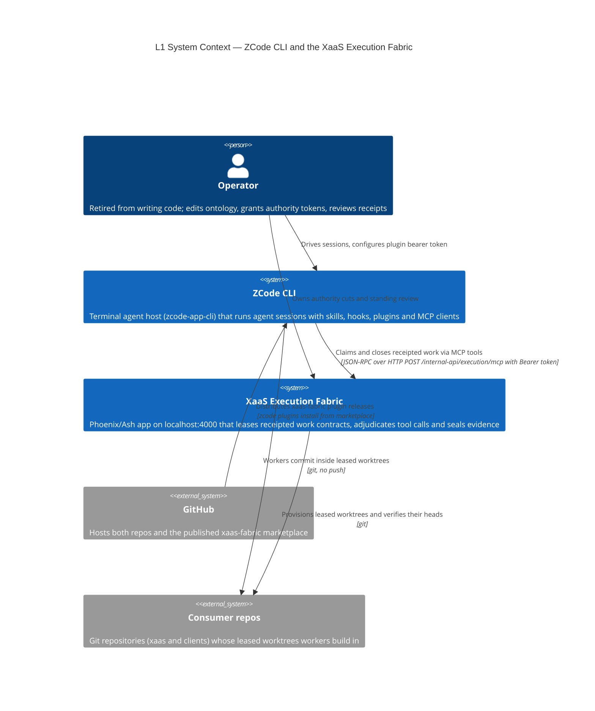
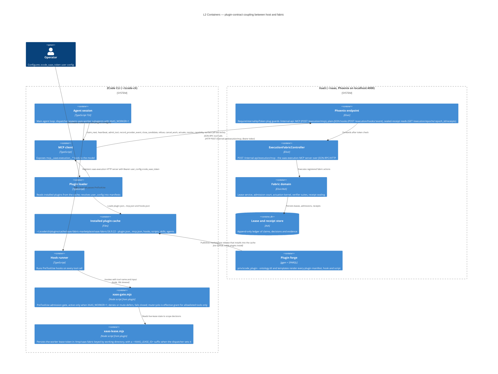
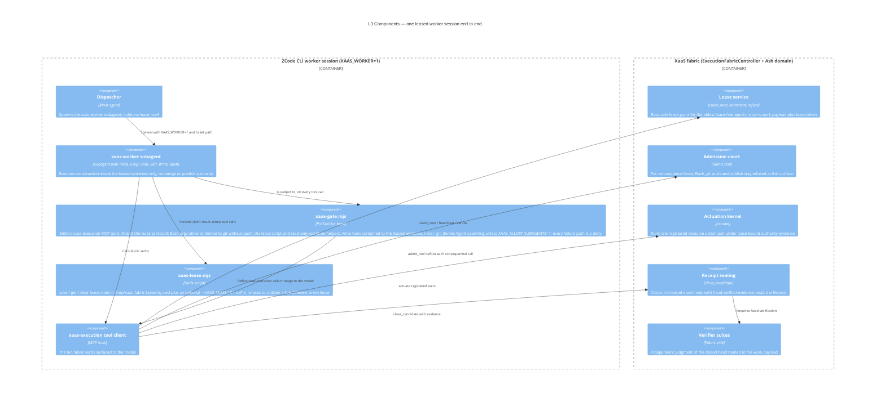

# C4 — zcode-cli ↔ xaas connections

Grounded in (2026-09-22; re-verified against source 2026-11-21):

- Plugin source (製-ed from ontology): `~/xaas/priv/zcode_plugin/` — `ontology.ttl`, ggen `templates/*.tmpl` (SPARQL-driven), rendered `marketplace/xaas-fabric/` (`plugin.json`, `.mcp.json`, `hooks/hooks.json`, `scripts/xaas-gate.mjs`, `scripts/xaas-lease.mjs`, `skills/xaas-worker/`, `agents/xaas-worker.md`, `commands/xaas.md`)
- Installed instance: `~/.zcode/cli/plugins/cache/xaas-fabric-marketplace/xaas-fabric/26.9.22/` (active `installed_plugins.json` path; refreshed from local marketplace `~/xaas/priv/zcode_plugin/marketplace`)
- Server side: `~/xaas/lib/xaas_web/router.ex:117` — `post("/execution/mcp", ExecutionFabricController, :mcp)` inside `scope "/internal-api"` (router.ex:96), piped through `[:api, :require_internal_api_token]` (router.ex:97), behind `RequireInternalApiToken`. The same scope also carries `POST /execution/hooks/:event` (router.ex:116, plain-JSON hook transport) and `GET /execution/epochs/:epoch_id/receipts` (router.ex:134, sealed-receipt read)
- Host contract: `~/zcode-cli/docs/HOST_INTEGRATION.md` (plugin manifests, user_config interpolation)
- Headless session registration: project `.mcp.json` in the working directory (2026-09-21 runtime rebuild); see [CONFIGURATION.md](./CONFIGURATION.md), "Headless session registration: the project `.mcp.json`"
- Launcher seam (re-verified 2026-11-21): `src/launcher.ts:873-875` — the native `zcode gall-work` invocation is intercepted before config bootstrap (`isGallWorkInvocation` at `src/gall-work.ts:273`, `parseGallWorkArgs` at `src/gall-work.ts:196`); the construct-stage argv carries NO goal text (`src/gall-work.ts:32`). Immediately following at `src/launcher.ts:882`, `runComplianceCommand` dispatches the hermetic EU AI Act & process-mining CLI (`src/compliance-cli.ts`). Fabric default port 4000: `~/xaas/config/dev.exs:13`, `~/xaas/config/runtime.exs:93`; internal-api health: `GET /internal-api/health` (`~/xaas/lib/xaas_web/router.ex:108`)

zcode-cli contains **zero** xaas-specific code; the entire coupling runs through three plugin contracts: the marketplace install, the `.mcp.json` MCP registration, and the `hooks.json` PreToolUse gate. Since xaas `1f429b4` (2026-09-20) there is a fourth, native surface in the other direction: the fabric dispatcher launches semantic runs with `zcode gall-work --lease <descriptor>` under the shared contract `~/xaas/priv/zcode_plugin/gall-work.contract.json` (byte-identical to `test/fixtures/gall-work.contract.json` here; both repos pin its sha256), implemented in `src/gall-work.ts` (landing on main from `w9-sweep/zcode-pr3`, commit `454ed62`) — a claim → persist → construct → close lifecycle alongside the gate and lease scripts. Since zcode-cli `c2adb24` (2026-09-26) the lease state file is keyed: when the dispatcher sets `XAAS_LEASE_ID` (the epoch id) the file gains a path-segment-sanitized `-<id>` suffix; without it the legacy per-cwd path is byte-identical. The gate and lease script must address the same key or a keyed worker is fenceless — source gate (and post-reinstall cache) reads **only** the keyed path when `XAAS_LEASE_ID` is set (no legacy fallback; wrong-epoch admission closed). Unkeyed sessions still use the legacy per-cwd `.json`. Operator refresh: `bash ~/xaas/priv/zcode_plugin/scripts/refresh-zcode-plugin-cache.sh` (never hand-edit `~/.zcode` cache; install identity must become `26.9.22/`).

## L1 — System Context



## L2 — Containers



## L3 — Components (runtime enforcement and the claim protocol)



## Dynamic — one claim-to-receipt cycle

```mermaid
C4Dynamic
    title Dynamic — worker claim, admission, construction, receipt

    System_Boundary(host, "ZCode CLI") {
        Component(dispatcher, "Dispatcher", "Main agent")
        Component(gate, "xaas-gate.mjs", "PreToolUse gate")
        Component(worker, "xaas-worker", "Leased subagent")
        Component(mcp, "MCP client", "xaas-execution tools")
    }

    System_Boundary(fabric, "XaaS fabric") {
        Component(controller, "ExecutionFabricController", "MCP over HTTP")
        Component(domain, "Fabric domain", "Leases, court, kernel, receipts")
        Component(worktree, "Leased worktree", "Git worktree in a consumer repo")
    }

    Rel(1, dispatcher, worker, "Spawns with ticket path and XAAS_WORKER=1")
    Rel(2, worker, mcp, "claim_next")
    Rel(3, mcp, controller, "POST /internal-api/execution/mcp, Bearer token")
    Rel(4, controller, domain, "Grants lease-free epoch and lease token")
    Rel(5, worker, gate, "Every tool call admitted or denied on the host")
    Rel(6, worker, worktree, "Edits and commits inside the leased worktree, never pushes")
    Rel(7, worker, mcp, "admit_tool before each consequential call; heartbeat renews lease")
    Rel(8, worker, mcp, "close_candidate with head-verified evidence")
    Rel(9, domain, worktree, "Verifies the exact closed head and seals the receipt")
    Rel(10, dispatcher, worktree, "Coordinator merges one serialized --no-ff when clean, writer-free and test-green")
```

## Notes

- **No hard-coded coupling in zcode-cli**: the endpoint URL, server name, tool surface and token key all arrive via the installed plugin manifest, themselves rendered from `zp:` ontology facts by ggen SPARQL templates — editing the endpoint is an ontology edit in xaas, not a code change in zcode-cli.
- **Token path**: operator runs `zcode plugins configure xaas-fabric@<marketplace> --options-file`; the loader interpolates `user_config.zcode_xaas_token` into the `Authorization` header (the `${user_config.*}` form exists because install-time plugin contexts have empty `env`).
- **Two enforcement planes**: the server-side `admit_tool` court (per-consequence fence) and the host-side `xaas-gate.mjs` PreToolUse gate (active only in dispatcher-launched sessions). Both fail closed; the gate's only explicit host signal is **deny** (mute allow = silent exit 0). Source law (active install `26.9.22/`, `cmp`-identical to `~/xaas/priv/zcode_plugin/marketplace/xaas-fabric/scripts/xaas-gate.mjs`): no `lease.verifier` Bash short-circuit, `SHELL_IS_NOT_AUTHORITY` for shell binaries, MCP tools require exact `port_tools` membership, keyed-only lease read when `XAAS_LEASE_ID` is set, policy load cannot widen the builtin floor (deny UNION / allow INTERSECT). Construct child env strips the full fabric `WorkerEnv` deny_names set plus ambient widener `XAAS_SWEEP` (`stripConstructChildEnv` in `src/gall-work.ts`) — gall-work spreads `process.env`, so deny strip is required; this is not a full allowlist rebuild.
- **Honesty — gall-work yolo mute-grant residual is OPEN**: construct always spawns `--mode yolo` (`src/gall-work.ts`) because a headless `--prompt` turn has no permission client and otherwise blocks on Bash. Under yolo, gate mute-allow is an **effective host grant** for tools that already passed the gate allowlists — not a widening of those allowlists. Ambient-env strips close inheritance wideners only. Closing the yolo residual needs a non-yolo headless permission client; tracked OPEN until that client exists.
- **OCEL evidence plane (host → xaas mining)**: `src/ocel-tap.ts` (`ZCODE_OCEL=1`, dir `ZCODE_OCEL_DIR`, default `~/.zcode/ocel`) redacts credential-shaped keys/values at ingest before the hash chain; under `XAAS_WORKER=1` the receipt binds scrubbed lease identity (`subject_sha`, `work_order_iri`, `epoch_id`, `base_sha`). Fail-closed post-redaction gate landed (sibling lane `61d6568f`, uncommitted on disk as of 2026-11-21): `OcelRecorder.finish` runs `containsUnredactedSecretsOrPii` / `prepareOcelDiskWrite` — survivors refuse the secret husk, seal standing `blocked`, set `redaction_refused`; lease identity fields are redact-or-refuse before bind/receipt (parity with [CAPABILITY_SNAPSHOT.md](./CAPABILITY_SNAPSHOT.md)).
- **Honesty — `chain_intact` is the OCEL tripwire, not the ALOOP seal**: receipt fields are orthogonal — `chain_intact` = OCEL `verifyChain` (pi_hash) AND `event_count > 0`; `receipt_chain_intact` = ALOOP `verify(chain)`. Seal standing is `"alive"` iff `chain_intact`, else `"blocked"`. Pre-fix, `chain_intact` falsely mirrored the ALOOP seal (empty taps looked intact).
- **Dual-log join sidecar**: stream and gall OCEL files that share a lease stay separate (no merge/rehash). Seal-time `sealDualLogJoinIfBothExist` writes `gall-work-<epoch>.join.json` (`zcode.dual-log-join/1`: `stream_ocel` / `gall_ocel` / `work_order_iri` / `epoch_id` + optional session namespaces) only when both `.jsonocel` files exist under the OCEL dir; mining helper `scripts/ocel-dual-log-join.ts` resolves or refuses.
- **Operator reinstall on skew**: never hand-edit `~/.zcode/cli/plugins/cache`. Check: `bash ~/xaas/priv/zcode_plugin/scripts/refresh-zcode-plugin-cache.sh --check`. Refresh: `zcode plugins marketplace update xaas-fabric-marketplace` then `zcode plugins update xaas-fabric@xaas-fabric-marketplace` (marketplace pin is the directory source `~/xaas/priv/zcode_plugin/marketplace`). Success identity is `.../xaas-fabric/26.9.22/` with source≡cache gate hash; a leftover `26.9.17/` tree is stale residue only (see `~/xaas/priv/zcode_plugin/plugin-src/README.md`).

- **Internal-api execution surface**: beyond the MCP endpoint, the scope serves `POST /execution/hooks/:event` (plain-JSON hook transport, added in fd829dc) and `GET /execution/epochs/:epoch_id/receipts` (org-scoped sealed-receipt read). The fabric controller registers ten MCP verbs (`@mcp_tools` at `execution_fabric_controller.ex:70`, dispatch at :431–569): `claim_next`, `heartbeat`, `admit_tool`, `record_provider_event`, `close_candidate`, `refuse`, `cancel_work`, `actuate`, `resolve_capability`, `surface`.
- **What each side can never do**: zcode-cli holds no ambient execution authority (a plugin tool call is not authority); the worker cannot push, spawn subagents, or write outside its leased worktree.
- **OCEL 2.0 telemetry, compliance & closed-loop receipts (2026-11-21)**: `src/ocel-tap.ts` (`ZCODE_OCEL=1`) emits credential-redacted, hash-chained OCEL events, and `src/gall-work.ts` seals the construct-turn `.jsonocel` stream (dual-log join) bound to lease identity (`subject_sha`, `work_order_iri`, `epoch_id`, `base_sha`) for xaas process mining. On the host side, `src/compliance/` + `src/compliance-cli.ts` implement IEEE OCEL 2.0 strict validation, XML/SQLite round-trip, event-time 180-day retention with SHA-256 `retention-purge-ledger.ndjson`, van der Aalst et al. process-mining checks (POWL v2, optimal A* alignment, Inductive Miner OCPN, OC-DFG, Kingman G/G/c scheduler, bounded transactional nets), EU AI Act (8/1/26) Articles 9–73 controls (incl. Art. 14 TUI oversight and Art. 50(2) provenance sealing), and the closed-loop `zcode foundry` (`R_t -> O*_{t+1}`) with Chatman-5 DFCM receipts validated by `bun run receipts:validate`.

## Five gaps (権証並票製)

Where the coupling is not yet at law (originally stated 2026-09-22; updated 2026-11-21).

- **権 (authority)** — gall-work landed on main (`w9-sweep/zcode-pr3`, `454ed62`); plugin `hooks/hooks.json` registers PreToolUse → `xaas-gate.mjs` with **no `enabled` field** (the prior "`hooks.enabled` now true" claim was stale — that flag is config-file hooks, not plugin hooks). The gate is inert unless `XAAS_WORKER=1`, and subagents bypass PreToolUse entirely — a documented runtime hole. Ambient deny-strip + `XAAS_SWEEP` strip landed (`stripConstructChildEnv` in `src/gall-work.ts`); **yolo mute-grant residual remains OPEN** until a non-yolo headless permission client exists (Honesty note above).
- **証 (evidence)** — *partially closed 2026-11-21*: schema-conformant Chatman-5 DFCM receipts now exist under `receipts/v26.9.22/`, `receipts/v26.9.23/`, and `receipts/v26.11.20/` with fail-closed validation (`bun run receipts:validate` / `scripts/validate-receipts.ts`), and `gall-work` seals lease-bound `.jsonocel` dual-log streams. Cross-repo ref-invalidation of stored standing remains tracked across the fabric boundary.
- **並 (scale)** — the MCP server was triple-registered until the 2026-09-22 dedupe, and a plaintext dev token sits in 3 files. The second xaas MCP server (`/mcp`) is unregistered, and `AuditMcpToolCall` covers `/mcp` but NOT `/internal-api/execution/mcp` — an audit asymmetry, tracked as an open work order.
- **票 (tickets)** — `docs/sjira/v26.9.22/` through `v26.11.20/` now exist; historical ticket-format divergence and the `_RUNBOOK.md` canonical form in `~/ggen_igniter` remain cross-repo harmonization items.
- **製 (manufacturing)** — the plugin is ggen-projected (`priv/zcode_plugin` ontology.ttl + templates) and cache-identical, while handwritten residue in `zcode-cli` is tracked in `HANDWRITTEN.md` with explicit UNSUPPORTED rows.

## Known open work orders

Successor orders live in `docs/sjira/v26.9.22/` (created 2026-09-22): the OCEL registry bridge, execution-mcp audit coverage, and ocel-verify CI.

## See Also

- Fabric-side runtime contract (ten verbs, policy surface): `~/xaas/docs/claude/diataxis/reference/ultracode-runtime-contract.md`
